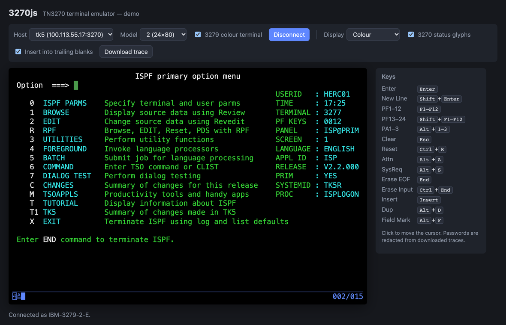

# 3270js

An IBM 3270 terminal emulator library for the browser and Node: TN3270 in
TypeScript, an [xterm.js](https://xtermjs.org/) analogue for IBM mainframes.



**Status:** Phase 1 complete (2026-11-22). Not yet published to npm. See
[SPEC.md](SPEC.md) and [docs/PLAN.md](docs/PLAN.md).

- **A complete 3278/3279 terminal, headless.** Telnet negotiation, the 3270
  data stream (every command and order), the field model, the keyboard with
  its locking rules, Read Modified/Buffer, Query Reply, and the status line.
  It has no dependencies and no DOM or Node APIs, so it runs in browsers,
  Node and Workers.
- **Two renderers.** A DOM renderer (native selection and copy, screen-reader
  announcements) and a canvas renderer (DPR-aware), with a live
  colour/monochrome switch and x3270's status-line glyphs.
- **Real keyboard handling.** PC keys map to 3270 keys, including PF1–24,
  PA1–3, Attn and SysReq, with IME and dead-key input and paste.
- **Transports.** A WebSocket transport for browsers, TCP for Node, and a
  WebSocket-to-TCP proxy that is never an open relay.
- **Scriptable.** Drive a mainframe from Node with no browser, as s3270 does.
- **Session traces.** Record, replay and share sessions, with passwords
  redacted.

## Try it

You need Node 24 and a TN3270 host: for example, Hercules running
[MVS 3.8j TK5](https://www.prince-webdesign.nl/tk5) (`infra/hercules-tk5/`
sets one up in Docker).

```sh
nvm use
npm install
HERCULES_HOST=<host> npm run dev      # then open http://localhost:5270
```

## Use it

In a browser:

```ts
import { Terminal } from '3270js';
import { DomRenderer, KeyboardMapper } from '3270js/dom'; // or CanvasRenderer from '3270js/canvas'
import { WebSocketTransport } from '3270js/websocket';

const term = new Terminal({ model: 2, color: true }); // announces IBM-3279-2-E
const renderer = new DomRenderer(document.getElementById('screen')!);
renderer.attach(term);
new KeyboardMapper(term, renderer).focus();
await term.connect(new WebSocketTransport('wss://example.org/tn3270?target=tk5'));
```

Headless, in Node, from a script:

```ts
import { Terminal } from '3270js';
import { TcpTransport } from '3270js/node';

const term = new Terminal();
await term.connect(new TcpTransport({ host: 'tk5.example', port: 3270 }));
term.onScreenSettled(() => console.log(term.text.join('\n')));
term.type('HERC03');
term.aid('ENTER');
```

The server side of the browser setup is `createWebSocketProxy()` from
`3270js/node`. Browsers can't open TCP connections, so the proxy relays them,
and clients choose a _named_ target from a fixed list.

| Entry point        | Contents                                                       |
| ------------------ | -------------------------------------------------------------- |
| `3270js`           | `Terminal`, the screen and keyboard models, code pages, traces |
| `3270js/dom`       | `DomRenderer`, `KeyboardMapper`                                |
| `3270js/canvas`    | `CanvasRenderer`, `KeyboardMapper`                             |
| `3270js/websocket` | `WebSocketTransport`                                           |
| `3270js/node`      | `TcpTransport`, `createWebSocketProxy`                         |

Sizes, minified and gzipped: core 12.6 KB, DOM 7.5 KB, canvas 8.1 KB,
WebSocket 0.5 KB.

### Default keys

| 3270             | PC                    |     | 3270                    | PC                  |
| ---------------- | --------------------- | --- | ----------------------- | ------------------- |
| Enter / New Line | Enter / Shift+Enter   |     | Clear                   | Esc                 |
| PF1–12 / PF13–24 | F1–F12 / Shift+F1–F12 |     | Reset                   | Ctrl+R              |
| PA1 / PA2 / PA3  | Alt+1 / Alt+2 / Alt+3 |     | Erase EOF / Erase Input | End / Ctrl+End      |
| Attn / SysReq    | Alt+A / Alt+S         |     | Insert                  | Insert              |
| Dup / Field Mark | Alt+D / Alt+F         |     | Backspace               | Erase (destructive) |

The keymap can be overridden. A browser or the operating system may take some
keys before the page sees them (F11 and F12, for example).

## How it is tested

| Level        | What                                                                                                                                                           | Command                    |
| ------------ | -------------------------------------------------------------------------------------------------------------------------------------------------------------- | -------------------------- |
| Unit         | 361 tests; core coverage 99.2% statements, 97.4% branches                                                                                                      | `npm test`                 |
| Differential | Every recorded TK5 screen (55 host records) and a 33-key script on 4 screens, compared cell for cell with **s3270**, x3270's scripting emulator                | `npm test` (needs `s3270`) |
| Browser      | Chrome, Firefox and WebKit × DOM and canvas. Real keystrokes walk through a replayed TK5 session; screenshot baselines; all 47 key bindings reach the terminal | `npm run test:e2e`         |
| Live         | Log on to TSO, then **edit, save and verify a member in Revedit** on a real TK5, through each renderer                                                         | `npm run test:e2e:live`    |

`npm run check` runs typecheck, lint, the unit and differential tests, and a
scan that keeps passwords out of committed traces.

## What Phase 1 taught us

Each of these was found on a real system and checked against s3270:

- **TK5's TSO only accepts extended (`-E`) terminal types.** A plain
  `IBM-3278-2` loops on `IKT00405I`. An `-E` terminal is sent a Read Partition
  Query, so Query Reply moved into Phase 1. The reply describes a green-only
  3278 unless colour is on.
- **On MVS 3.8, `ALLOCATE` has no DCB keywords.** Define them with `ATTR` and
  apply them with `ALLOC … USING(name)`.
- **A dropped session waits for reconnect.** Use `LOGON user RECONNECT`, then
  PA2 to redraw the panel. Cancelling the user instead can leave VTAM not
  painting the terminal until you press Clear.
- **Hercules negotiates one connection at a time.** A client that connects and
  stays silent blocks everyone until it times out.
- **TSO writes `***` over panels** (`*** e command C6TUTOR…`). Look for a line
  _starting_ with `***`, not ending with one.
- **Revedit (TK5's editor) reads line commands at the right-hand end** of
  `******`: `****I1` works, `I1****` doesn't.
- **Insert mode needs nulls, as on a real 3270.** TK5 fills its fields with
  blanks, so x3270's "blank fill" option (`keyboard.blankFill`) is off by
  default and on in the demo.

## Roadmap

- **Phase 2:**
  - TN3270E (named LUs, BIND, SYSREQ/Attn as protocol functions, and the
    `X -f` minus-function status indicator, which depends on them)
  - colour and highlighting compared against s3270
  - character reply mode
  - more code pages
  - the optional 3270 font
- **Phase 3:**
  - SimH Assist integration: a passive server-side copy of the session, the
    Docent filling in fields, password-safe logging, session replay
  - a public scripting helper, for example "wait for this text, then type"

## License

MIT © 2026 Richard Comish. Status-line glyphs come from x3270's fonts (BSD-3);
see [THIRD_PARTY_NOTICES.md](THIRD_PARTY_NOTICES.md).
