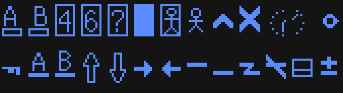

# ADR 0001: Font and status-line (OIA) glyphs

- **Status:** accepted (Richard, 2026-11-22)
- **Date:** 2026-11-22
- **Plan task:** 17. Blocks task 18 (canvas renderer) and the glyph version of the DOM status line.

## Context

The status line (Operator Information Area) of a real 3278/3279 uses special
symbols that no ordinary font has. SPEC §11 requires showing them properly,
including the Attn and SysReq indicators, the input-inhibited X with clock,
and "do not enter".

What exists:

1. **The "3270" font** by Ricardo Bánffy (github.com/rbanffy/3270font): a
   modern TrueType font derived from x3270's bitmap fonts.
   - **Licence:** BSD-3-Clause; the source is also available under OFL-1.1.
     Two logo glyphs carry other terms (Debian, Ubuntu). Neither matters if we
     keep the notice.
   - **Formats:** TTF, OTF and WOFF (108 KB for Regular). No WOFF2 is
     published.
   - **APL:** 69 APL code points are encoded.
   - **Status-line glyphs:** present, but **unencoded**. They have no Unicode
     code point, so CSS text cannot reach them.
2. **Unicode** has no 3270 status-line characters, only rough stand-ins (stick
   figures U+1FBC5–9, negative squared question mark U+1FBC4, watch U+231A).
3. **x3270's bitmap fonts** (BDF; BSD-3; Paul Mattes) contain every
   status-line glyph at known positions in the 3270 character generator
   order. Browsers can't load BDF.
4. **Other web emulators** draw their status lines in plain ASCII stand-ins
   (zowe tn3270-ng2) or Unicode arrows (IronTerm). None uses the real glyphs.

The status-line glyphs from x3270's 3270-20 font, at 4× (rendered from the
BDF for this ADR):

- **Row 1:** boxA, boxB, box4, box6, boxquestion, boxsolid, boxhuman, human
  ("go elsewhere"), insert, lock (the input-inhibited **X**), clockleft,
  clockright, keyleft
- **Row 2:** keyright, underA, underB, upshift, downshift, rightarrow,
  leftarrow, commhi, commlo, commjag, badcommhi, magcard, plusminus

## Decision

1. **Text font.** Offer the 3270 font as an *optional* asset, not baked into
   the bundle:
   - Ship it as `3270js/fonts/3270-Regular.woff` (WOFF2 later, once we can
     convert it), with its licence notice, plus a small CSS `@font-face`
     snippet.
   - The default theme already lists `"3270"` first and falls back to the
     platform monospace font.
   - Embedders who want the authentic look add one stylesheet; everyone else
     pays nothing.
2. **Status-line glyphs.** Draw them ourselves from x3270's BDF bitmaps:
   - A build script converts the glyphs above into a tiny module of 1-bit
     bitmaps, about 26 glyphs at 10×20, roughly 1 KB.
   - The DOM renderer draws each one as an inline SVG path scaled to the cell
     size; the canvas renderer draws the same bitmap.
   - The result is pixel-identical to x3270, crisp at any size, independent of
     the text font, and needs no font patching.
   - The BSD notice for the glyph data goes in `THIRD_PARTY_NOTICES`.
3. **Fallback.** Keep the readable words (`X SYSTEM`, `X Wait`…) as the
   accessible text of each indicator (`aria-label` / `title`), and as the
   rendering when glyphs are turned off.

## Alternatives considered

- **Patch the 3270 font,** mapping its unencoded glyphs into the Private Use
  Area. One mechanism for everything, but we'd maintain a font fork and a
  FontForge toolchain, and PUA characters copy-paste as garbage. Rejected.
- **Unicode stand-ins only.** No assets, but not what a 3270 looks like, which
  is the point of the project. Rejected.
- **Bundle the font by default.** About 100 KB more for every embedder, most
  of whom don't need it. Rejected in favour of opt-in.

## Consequences

- One small generated data module and a converter script (`scripts/gen-oia-glyphs.py`).
- The OIA layout becomes a fixed 80-column grid of cells, like the real one,
  shared by both renderers.
- Third-party notices: BSD-3 for the x3270 glyph data; BSD-3/OFL for the
  optional font.

## Resolved at sign-off

- **Attn and SysReq are keys, not status-line glyphs.** They belong in the
  keyboard mapping (task 19): both must be reachable from a PC keyboard.
- **Reference: photos of a real 3278-2 status line** (the owner's photos, not
  committed). Left to right:
  - `S`, an underlined/boxed `A` and a **solid block** (x3270's `underA` and
    `boxsolid` style)
  - at column 8, **`X -f`**: input inhibited, "minus function" (the function
    isn't available)
  - an **up arrow** in the middle (`upshift`, the shift indicator)
  - at the right, `▭-▭01`, `DOC` and a **down arrow** (`downshift`)

  A colour terminal shows the same `SA▌` in blue.

## Follow-ups this adds

1. A **minus-function** lock state (`X -f`): a key whose function isn't
   available (x3270 `KL_OIA_MINUS`, e.g. SysReq or Attn when the session can't
   use it). Add it to `OperatorError`/the OIA model and the status line.
2. **Shift indicators** (`upshift` / `downshift`), driven by the browser's
   Shift and Caps Lock state, as a real terminal shows its shift state.
3. Lay out the status line by the 3174 OIA column positions, matching the
   photo, so connection symbols sit at columns 0–2 and the input-inhibited
   area starts at column 8.
